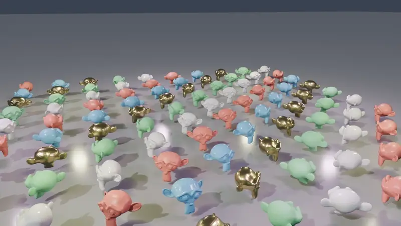
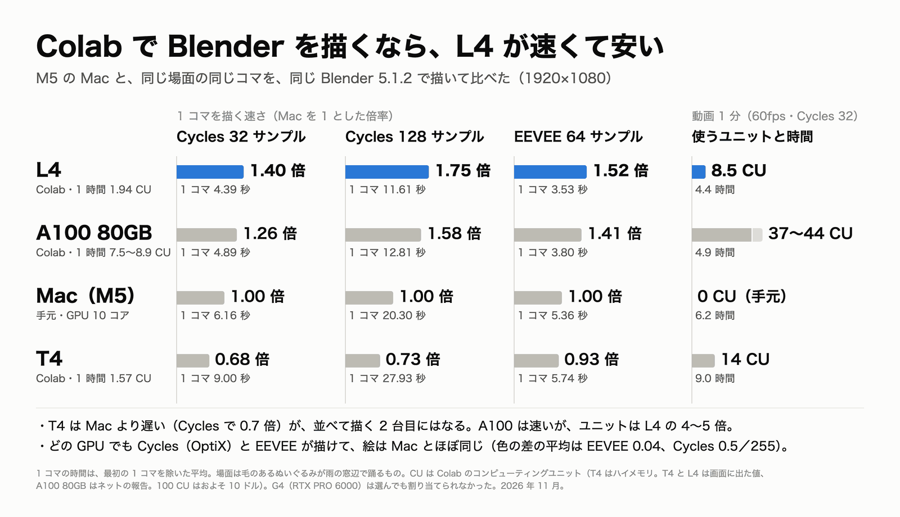

# claude-colab-render（クロード・コラボ・レンダー）

Blender の描画（EEVEE・Cycles）を Google Colab の GPU に出して、Google Drive に連番と MP4 を書き出す、Claude Code のスキルとノートブック。

[](https://docs.anthropic.com/en/docs/claude-code)
[](https://www.anthropic.com/claude)
[](./LICENSE)
[](https://colab.research.google.com/github/tanuu5/claude-colab-render/blob/main/notebooks/demo_eevee.ipynb)
[](#english)

<p align="center">
  
</p>

<p align="center"><b>▶ 見本を Colab で開く：<a href="https://colab.research.google.com/github/tanuu5/claude-colab-render/blob/main/notebooks/demo_eevee.ipynb">EEVEE</a> ／ <a href="https://colab.research.google.com/github/tanuu5/claude-colab-render/blob/main/notebooks/demo_cycles.ipynb">Cycles</a></b></p>

**Claude Code × Claude Opus 5.5（MAX）** で作りました。

Mac で何時間もかかる Blender の描画を、Google Colab の NVIDIA の GPU（L4 など）に出すための道具です。区切りごとに描いて Google Drive に書き出し、途中で切れても続きから描き、描き終えたら MP4 を作って、ランタイムを自分で手放します。1 コマが CPU を待つ場面では、1 台の GPU に Blender を並べて描けます（機械のメモリが埋まる前に 1 個止める見張りつき）。Claude Code のスキルとして入れると、「この場面を Colab で描いて」と頼むだけで、場面の確かめ・zip づくり・ノートブックの用意までを Claude が進めます。
上の映像は、見本の場面（`scripts/demo_scene.py`）を描いたものです。見本のノートブックは、この場面をノートブックの中で組み立てて 120 コマ描き、4 秒の MP4 にします。Colab で開いて「すべてのセルを実行」を押し、Drive へのアクセスを許可するだけで、仕組みを通しで試せます（手順は下の「見本を試す」）。

## 結果：M5 の Mac と比べて

<p align="center">
  
</p>

- **いちばん速く、1 コマあたりいちばん安いのは L4** でした。Cycles で Mac の 1.4〜3 倍（場面で変わります。下の表）、1 時間 1.94 ユニットです。
- **EEVEE は、アニメとして続けて描くと L4 で 1 コマ 2.42 秒**（Blender の立ち上げ込み）になり、Mac の 2.2 倍でした。Mac は続けて描いても変わりません（5.40 秒）。続けて描く形が効くのは Colab の側です。
- **T4** は Mac より遅く（Cycles で 0.7 倍）、**A100** は L4 より遅いうえ、ユニットは 4 倍ほど使います。G4（RTX PRO 6000）は、選んでも割り当てが進まず、A100 に回されました（プレミアム GPU は Pro+ が優先です）。
- **絵は Mac とほぼ同じ**です（色の差の平均は、EEVEE で 0.04〜0.08/255、Cycles で 0.09〜0.5/255）。
- 毎月 200 ユニット（作者が契約した Google AI Pro に付く Colab の特典。Colab Pro だけなら毎月 100）あれば、L4 を 100 時間ほど回せます（準備の時間を含めて）。夜通しの描画を、手元の PC にさせずに済みます。

### 速さは場面で大きく変わる

上の図は、毛があって GPU の仕事が重い場面のものです。L4 の速さ（Mac を 1 とした倍率）は、場面によって次のように変わりました。

| 場面 | 描き方 | L4 の速さ |
|---|---|---|
| 毛のあるぬいぐるみが、雨の窓辺で踊る（上の図） | Cycles・32〜128 サンプル | 1.40〜1.75 倍 |
| 同じ場面 | EEVEE・アニメとして続けて | 2.2 倍 |
| 小さなキャラクターが石畳の広場を歩いて、水たまりで跳ねる屋外の場面（動きのぼけ、小石 5,600 粒、水たまりの屈折） | Cycles・128 サンプル | 2.9〜3.2 倍 |
| 見本の場面（猿の頭 100 体。毛のない軽い場面） | EEVEE・アニメとして続けて | ほぼ同じ（1 コマ 2.11 秒と 2.16 秒） |
| コードで組み立てる夜の屋外の舞台（コマごとに Python で人と観客を置く） | EEVEE・アニメとして続けて | 0.8〜0.9 倍（Blender 1 個、立ち上げ込み） |

- **GPU の仕事が重い場面ほど、L4 の差が出ます。** 屋外の場面は 768 コマを 1 時間 2 分で描き終え、GPU の使用率は平均 91% でした。上の図の倍率で割って出した見積もり（2.3〜3 時間）は、大きく外れました。
- **1 コマが CPU を待つ場面では、L4 1 個は Mac より遅くなりました**（場面をコードで組み立てる立ち上げが、L4 は 270 秒、Mac は 81 秒）。そのあいだ GPU は空いているので、1 台の L4 に Blender を 2 個並べると、1 個の 1.49 倍進みました（下の「しくみ」の `workers`）。
- 見積もりは、自分の場面を手元と Colab で数コマずつ描いて比べるのが確かです（準備を入れても 1 ユニットかかりません）。
- 同じ場面の続きを描くなら、手元の下書きの 1 コマの時間を前の作品と比べ、その比で前の Colab の秒数を伸ばすと当たりました（屋外の場面の続編で「1 コマ 5 秒前後」と見積もって、936 コマを 1 コマ 5.05 秒、1 時間 19 分で描き終えました）。

見本の場面のほかは作者の作例で、場面そのものは公開していません（このリポジトリにも入っていません）。数字のくわしい表と測り方は [references/gpu-table.md](references/gpu-table.md) にあります（2026 年 11 月の値。立ち上げを含むかなど、測り方は場面ごとに少し違います。1 時間あたりのユニットは、Colab の画面に出た値とネットの報告です）。

## しくみ

- **区切りごとに描いて Drive へ**：1 回の Blender で数十〜数百コマを描き、描き終えた区切りを Google Drive に写して、印を付けます。
- **途中から続けられる**：ランタイムが切れても、同じノートブックをもう一度実行すれば、印のある区切りは飛ばして続きから描きます。
- **MP4 まで作る**：全部描き終えたら、Colab の中で ffmpeg を使って MP4 を作ります。色のタグは BT.709 の原色と sRGB のガンマ（macOS の QuickTime などで、PNG と同じ色に見えます）。
- **ランタイムを自分で手放す**：描き終えたとき、または先へ進めなくなったときに手放して、ユニットの消費を止めます。手放す前に、Drive への書き込みを送りきります。
- **描く前に GPU を確かめる**：Cycles は OptiX（だめなら CUDA）、EEVEE は NVIDIA の OpenGL（EGL）で描けるかを見て、CPU に落ちていたら描かずに止まります。
- **Mac 用の設定を GPU に戻す**：Mac で書いたスクリプトが Metal を決め打ちしていると、Linux では黙って CPU に落ちます。`gpu_pick.py` を前に読ませると、描く直前に GPU へ戻します（作品のファイルは変えません）。
- **頼んでいない GPU を断る**：G4 を頼むと A100 に回されることがあります。`accept_gpus` に使ってよい GPU を書いておけば、ほかの GPU ならすぐに手放します。
- **1 台の GPU に Blender を並べる（`workers`）**：1 コマが GPU ではなく CPU を待っている場面（コマごとの場面の評価が重い、コマごとに Python で物を置くなど）では、区切りをいくつか同時に描けます。作例の場面では、L4 に 2 個並べて 1 個の 1.49 倍進みました（GPU の使用率は平均 30%）。
- **メモリの見張り（`ram_limit`）**：並べた Blender が機械のメモリ（GPU のメモリではなく、ランタイムの RAM）を埋めると、Colab はランタイムを何も言わずに切ります。作例の場面では、3 個並べて 55.5GB のうち 54.0GB まで埋まり、2 回とも切れました。並べているあいだ、メモリの使用が 85%（`ram_limit` で変えられます）を超えたら、いちばん後に始めた Blender を止めて、1 個少ない数で続けます。止めた区切りは、空きができてから描き直します（Mac で、埋まったふりをさせて試しました。Colab で本当に埋まったときに間に合うかは、まだ確かめていません）。
- **1 分ごとの記録と、まとめの数字**：描いているあいだ、CPU の込み具合・機械のメモリ・GPU の使用率とメモリを、1 分ごとに Drive の書き出し先の `_colab_render/watch.txt` に書きます（ランタイムが切れても残ります）。まとめ（`summary.json` と、最後の「まとめ:」の行）には、その平均と山（`gpu_util_mean`・`gpu_mem_peak_mb`・`ram_peak_gb`・`load_mean`）が入るので、場面が GPU と CPU のどちらを待っているか、もう 1 個並べられるかが分かります。`echo` に正規表現を書けば、区切りを描き終えるたびに、Blender のログから合う行（たとえば 1 コマの時間）も出します。

## 使い方

### 見本を試す

1. 上の「見本を Colab で開く」から、EEVEE か Cycles のノートブックを開きます（[notebooks/](notebooks/) のファイルを、Colab の「ファイル」→「ノートブックをアップロード」で開いても同じです）。
2. 「ランタイム」→「ランタイムのタイプを変更」で GPU を選びます（ふだんは L4）。
3. 「ランタイム」→「すべてのセルを実行」を押し、Google Drive へのアクセスを許可します（項目を選ぶ欄が出たら、全部にチェックを入れます）。許可の画面が出るので、ここだけはその場にいる必要があります。
4. 終わると、Drive の `マイドライブ/colab_render/out/demo_eevee/`（Cycles なら `demo_cycles/`）に 120 枚のコマと MP4 ができています。ランタイムは自分で手放されます。

### 自分の場面を描く

1. .blend が外のファイルに頼っていないかを確かめます：`blender -b scene.blend -P scripts/blend_check.py`（`-- --pack --save bundle/scene.blend` で、外のファイルを中に入れた写しを作れます）。
2. 場面一式を zip にします：`python3 scripts/make_bundle.py --root <フォルダ> --top my_scene --out my_scene.zip scene.blend`
3. 仕事の設定を書きます：[assets/job_bundle_example.json](assets/job_bundle_example.json) をもとに、描く命令・コマの範囲・区切りの大きさ・書き出し先・MP4 の設定を書きます。1 コマが CPU を待つ場面なら、下の「Blender を並べて描く」も見てください。
4. ノートブックを作ります：`python3 scripts/make_notebook.py job.json --out my_scene.ipynb`
5. zip を Drive の `マイドライブ/colab_render/` に置き、ノートブックを Colab で開いて、見本と同じ手順で実行します。

`scripts/colab_job.py` は手元の Mac でもそのまま動くので、Colab に出す前に、zip を開いた一式から数コマ描いて確かめられます。くわしい手順と、EEVEE と Cycles の扱いの違いは [SKILL.md](SKILL.md)、つまずきやすい所は [references/troubleshooting.md](references/troubleshooting.md) にあります。

### Blender を並べて描く（`workers`）

job に次の項目を足すと、1 台の GPU で Blender を 2 個ずつ動かします（`ram_limit` と `echo` は、なくてもかまいません）。

```json
"workers": 2,
"ram_limit": 0.85,
"echo": "Time: "
```

- **まず 1 個で描いて、まとめを見ます。** `gpu_util_mean`（GPU の使用率の平均）が低ければ、GPU が空いていて、並べる値打ちがあります。作例では、Cycles の重い屋外の場面は 1 個で 91%（GPU はほぼふさがっていた）、CPU を待つ場面は 2 個並べても 30% でした。
- **数は、機械のメモリで決めます。** Blender 1 個ごとに、場面ぶんのメモリを使います。1 個で描いたときのまとめの `ram_peak_gb`（機械のメモリの山）や `watch.txt` を目安に、個数ぶんがランタイムのメモリ（L4 は 55.5GB）に収まる数にします。手元の Mac で測った値は、目安になりませんでした（作例の場面で、Mac は 8.4GB、L4 では 1 個 17GB 前後）。
- **区切りは長めにします。** Blender ごとに、立ち上げと場面の用意がかかるためです（作例では、60 コマの区切りで時間の 3 割が立ち上げでした）。
- 並べたときのまとめの `s_per_frame` は、かかった時間 ÷ コマ数です。Blender 1 個の中での 1 コマは `s_per_frame_each` に入ります。

### Claude Code のスキルとして入れる

```bash
git clone https://github.com/tanuu5/claude-colab-render.git ~/.claude/skills/colab-render
```

「この場面を Colab で描いて」「描画を Mac と分けて描きたい」などと頼むと、Claude が SKILL.md の手順で、見積もり（時間とユニット）・場面の確かめ・zip・ノートブックを用意します。人がするのは、zip を Drive に置くことと、Colab の操作（ノートブックを開く、GPU を選ぶ、Drive の許可）です。

## 実際の出力（Colab の L4 で、EEVEE を 120 コマ）

```text
START ぬいぐるみの 1〜120 コマ（EEVEE を Drive に描く試し）: frames 1-120 in 2 chunk(s); 120 frame(s) to render
done 1-60: 60 frame(s) in 0:02:34 (2.57 s a frame with Blender's start), 60 left, about 0:02:34 to go
done 61-120: 60 frame(s) in 0:02:16 (2.27 s a frame with Blender's start), 0 left, about 0:00:00 to go
ALL DONE: 120 frame(s) rendered now, 0 chunk(s) done before; 2.42 s a frame; output in /content/drive/MyDrive/colab_render/out/nui_test_eevee
VIDEO making nui_test_eevee.mp4 from 120 frame(s) at 60 fps
VIDEO written /content/drive/MyDrive/colab_render/out/nui_test_eevee/nui_test_eevee.mp4 (4.9 MB, 6 s)
```

## 必要なもの

- **Google Colab**（GPU のランタイム）。コンピューティング ユニットを使うので、Colab Pro や、Google AI Pro に付く Colab の特典などの有料の枠があると安心です。
- **Google Drive**：描いたコマと MP4 の置き場です。1080p の PNG は 1 枚 2〜3MB なので、数千コマなら数 GB〜20GB ほど要ります。
- Blender（Linux 版）と NVIDIA の部品は、ノートブックが公式の配布元から自動で取ってきます。
- 手元で道具を使うなら：Python 3（標準のライブラリだけ）、Blender（`blend_check.py`・`demo_scene.py`・手元での試し描き）、ffmpeg（手元で MP4 を作るとき）。

## 注意

- コンピューティング ユニットはお金です。描く前に、1 コマの秒数 × コマ数 × 1 時間あたりのユニットで見積もってください。速さは場面で大きく変わるので、長い描画なら、Colab でも数コマ描いて測ってから見積もると確かです。
- Blender を並べるとき（`workers`）は、機械のメモリに気をつけてください。埋まると、Colab はランタイムを何も言わずに切ります（メモリの見張りは保険です）。
- ブラウザのタブは開いたままにして、PC はスリープさせないでください。
- 1 本の動画を手元と Colab で分けて描くときは、コマを交互にせず、ひと続きの区間（ショットの切れ目）で分けてください。絵がわずかに違うため、交互だとちらつきになりえます。Blender の版もそろえてください。
- ノートブックの見出しと表示は日本語です。

## 制作について

企画・ディレクション：**たぬ**　／　開発：**Claude Code（Claude Opus 5.5・推論レベル MAX）**

Mac で何時間もかかる描画を Colab に出せないか、という相談から始めました。描く時間の内訳を測り、作者の作例で T4・A100・L4 を測ってから、Drive に描く流れを作りました。スクリプト・ノートブック・図は Claude が書き、手元（Mac）で通してから、Colab で Cycles と EEVEE の両方を通しています（Colab の操作は作者）。

1 台の GPU に Blender を並べて描く機能（`workers`）・1 分ごとの記録・メモリの見張りは、Claude Code（Claude Fable 5.2・推論レベル HIGH）が書きました。Colab の L4 で 2 個並べを通し、3 個並べでランタイムが切れた記録から、メモリの見張りを足しています。

## 更新履歴

- **2026-11-27**：1 台の GPU に Blender を並べて描く `workers`、メモリの見張り `ram_limit`、1 分ごとの記録 `watch.txt` とまとめの使用率・メモリの欄、ログの行を出す `echo` を足しました。速さの表に、L4 が Mac の 3 倍だった Cycles の屋外の場面と、CPU を待つ場面を足し、見本のノートブックを新しいスクリプトで作り直しました。同じ場面の続編で見積もりが当たった記録（下書きの比で見積もる）も足しました。
- **2026-11-22**：公開

## クレジット・ライセンス

- このリポジトリのスクリプト・ノートブック・文章・図は [GPL-3.0-or-later](LICENSE) です（© 2026 たぬ）。Blender の Python API を使うスクリプトを含むため、Blender と同じ GPL にしています。
- Blender と NVIDIA のドライバーの部品は、このリポジトリには入っていません。ノートブックが、使う人の Colab の中で、それぞれの公式の配布元から取ってきます。
- このツールで描いた絵や動画に、このライセンスは掛かりません。
- Google Colab と Google Drive は Google LLC の、Blender は Blender Foundation の商標です。
- GPL の対象は、このリポジトリのコードと文章です。「Claude」の名前や商標の使用を許諾するものではありません。

## English

A Claude Code skill and Colab notebooks that render Blender frames (EEVEE or Cycles) on Google Colab's NVIDIA GPUs, write them to Google Drive chunk by chunk, resume where a run stopped, make an MP4, and release the runtime when done. Made with **Claude Code × Claude Opus 5.5 (MAX)**.

- **Try it**: open the [EEVEE demo](https://colab.research.google.com/github/tanuu5/claude-colab-render/blob/main/notebooks/demo_eevee.ipynb) or the [Cycles demo](https://colab.research.google.com/github/tanuu5/claude-colab-render/blob/main/notebooks/demo_cycles.ipynb) in Colab, pick a GPU runtime (L4 recommended), Run all, and allow Drive access. The demo scene is built inside the notebook; 120 frames and an MP4 land in `My Drive/colab_render/out/`.
- **Results** (against an Apple M5 Mac, Blender 5.1.2): the L4 was the fastest and the cheapest per frame. How much faster depends on the scene: Cycles ran 1.40–1.75× on a GPU-heavy scene with fur and 2.9–3.2× on a heavy outdoor scene (motion blur, thousands of pebbles, a refracting puddle, 128 samples); EEVEE ran 1.52× frame by frame and 2.2× when rendered as one animation (`-a`). On the lighter demo scene the L4 and the Mac were about equal (2.11 and 2.16 s a frame), and on a scene whose frames wait on the CPU a single L4 was slower than the Mac. The T4 is slower than the Mac; the A100 is slower than the L4 at about four times the compute units.
- **Several Blenders on one GPU** (`workers`): for scenes whose frames wait on the CPU; two Blenders on one L4 went 1.49× as fast as one. While they run, a memory guard (`ram_limit`, 85% by default) ends the youngest Blender before the runtime's RAM fills up (Colab ends such a runtime without a word), and `_colab_render/watch.txt` on Drive logs the load, the RAM and the GPU every minute.
- **Your own scene**: check it with `scripts/blend_check.py`, zip it with `scripts/make_bundle.py`, describe the job in a JSON file (see `assets/job_bundle_example.json`), and build the notebook with `scripts/make_notebook.py`.
- The notebooks' text and messages are in Japanese.
- License: GPL-3.0-or-later (© 2026 たぬ). Blender and NVIDIA's driver files are downloaded by your own runtime from their official sources; nothing of theirs is redistributed here.
